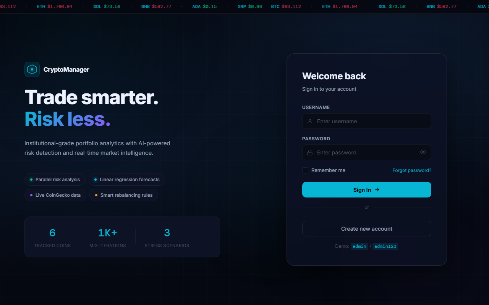
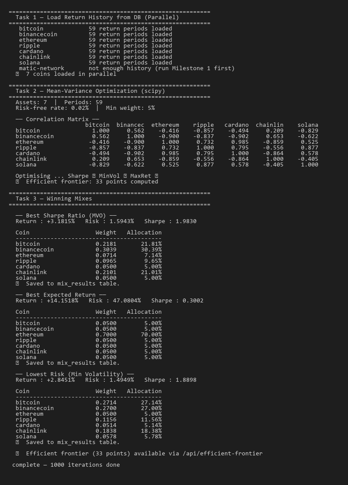
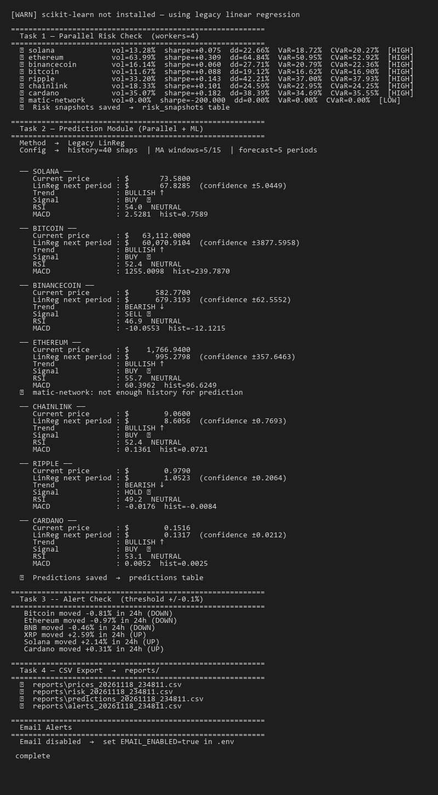
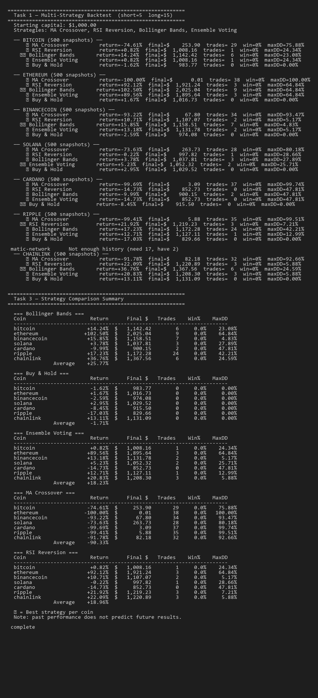

# QuantRisk: Autonomous Cryptocurrency Risk & Portfolio Optimization Engine

Quantitative portfolio management, risk analytics, and algorithmic backtesting platform built in Python and Flask. Engineered from scratch during the Infosys Springboard 6.0 internship program to model empirical asset covariance, calculate the Markowitz Efficient Frontier, and evaluate downside tail risk using Monte Carlo simulations.

Live Deployment: https://cryptomanagerapp.vercel.app

---

## System Overview

Cryptocurrency assets display pronounced fat-tailed distributions, rapid volatility spikes, and sudden breakdowns in asset diversification during market stress. Standard consumer tracking tools merely display price histories without quantifying correlation dynamics or downside capital exposure.

QuantRisk models these dynamics mathematically:
1. Historical price series are retrieved from the CoinGecko API and structured into local SQLite tables.
2. The portfolio engine calculates empirical covariance matrices and applies Sequential Least Squares Programming (SLSQP) to determine optimal capital weights that maximize the Sharpe ratio.
3. The risk analytics module evaluates historical and parametric Value at Risk (VaR) and Conditional VaR (Expected Shortfall) at the 95% and 99% confidence tiers.
4. Downside stress testing generates one thousand stochastic price paths using Monte Carlo simulations.
5. The backtesting subsystem simulates algorithmic trading strategies against historical price bars.

---

## Application Interface & Screenshots

### Web Analytics Dashboard
The Flask web interface presents portfolio allocations, daily returns, correlation matrices, and risk metrics in real time, pulling live quotes and calculating portfolio health on demand.



### Modern Portfolio Theory and Covariance Matrix
The mixing calculator aligns multi-asset historical returns, computes the empirical covariance matrix, and executes constrained optimization to establish the Efficient Frontier.



### Downside Tail Risk and Monte Carlo Simulation
The risk prediction engine models tail risk using parametric and historical Value at Risk (VaR), Conditional VaR, and stochastic Monte Carlo stress testing across simulated volatility regimes.



### Algorithmic Trading Strategy Backtest
The backtesting engine evaluates historical performance of Moving Average Crossover, Relative Strength Index (RSI), and Bollinger Band breakout strategies with transaction cost modeling.



---

## Mathematical Formulation

### 1. Modern Portfolio Theory Optimization
For an asset universe with return vector $\boldsymbol{\mu}$ and covariance matrix $\boldsymbol{\Sigma}$, the portfolio expected return and variance are defined as:

$$\mathbb{E}[R_p] = \mathbf{w}^T \boldsymbol{\mu}$$

$$\sigma_p^2 = \mathbf{w}^T \boldsymbol{\Sigma} \mathbf{w}$$

The optimization solver maximizes the Sharpe ratio subject to full investment and minimum allocation constraints:

$$\max_{\mathbf{w}} \frac{\mathbf{w}^T \boldsymbol{\mu} - R_f}{\sqrt{\mathbf{w}^T \boldsymbol{\Sigma} \mathbf{w}}} \quad \text{subject to} \quad \sum_{i=1}^{n} w_i = 1, \quad w_i \ge w_{\min}$$

### 2. Downside Tail Risk Modeling
Loss distributions are evaluated using historical simulation at confidence level $\alpha$:

$$\text{VaR}_\alpha(L) = \inf \{ l \in \mathbb{R} : P(L > l) \le 1 - \alpha \}$$

$$\text{CVaR}_\alpha(L) = \mathbb{E}[L \mid L \ge \text{VaR}_\alpha(L)]$$

Unlike standard variance, Conditional VaR explicitly captures the expected magnitude of catastrophic losses in the tail of the distribution.

---

## Repository Structure

```text
CryptoManager/
├── app.py                       # Flask web service and dashboard routing
├── config.py                    # CoinGecko endpoints, API settings, and asset parameters
├── database.py                  # SQLite relational schema, caching, and API connectors
├── main.py                      # Interactive terminal CLI execution menu
├── milestone1_setup.py          # Workspace initialization and validation
├── milestone2_mix_calculator.py  # Covariance matrix calculation, MPT, and SLSQP optimization
├── milestone3_risk_predictor.py  # Monte Carlo simulation, VaR, CVaR, Sortino, and Calmar ratios
├── milestone4_spreading_rules.py # Risk parity asset distribution and dynamic rebalancing rules
├── milestone5_backtest.py       # Algorithmic trading simulation (SMA, RSI, Bollinger Bands)
├── tests/                       # Automated pytest verification suite
└── .github/workflows/           # GitHub Actions CI pipeline
```

---

## Quick Start

### 1. Clone & Environment Setup
```bash
git clone https://github.com/harctik/Crypto-Investment-Manager.git
cd Crypto-Investment-Manager
python -m venv venv

# Windows:
venv\Scripts\activate
# Linux/macOS:
source venv/bin/activate

pip install -r requirements.txt
```

### 2. Launch the Web Dashboard
```bash
python app.py
# Access http://localhost:5000 in your browser (admin / admin123)
```

### 3. Run the CLI Engine
```bash
python main.py
```

### 4. Execute Unit Tests
```bash
pytest tests/ -v
```

---

## Author and Engineering Details

All mathematical modeling, risk calculations, backtesting algorithms, and software implementation in this repository were engineered end-to-end by Avvari Naga Harthikanand (Harthik) as part of the Infosys Springboard 6.0 program.

Developer: Avvari Naga Harthikanand
Location: Bangalore, Karnataka, India
LinkedIn: https://www.linkedin.com/in/harthik
GitHub: https://github.com/harctik
Email: harthikanand90@gmail.com
Live Demo: https://cryptomanagerapp.vercel.app
License: MIT License
