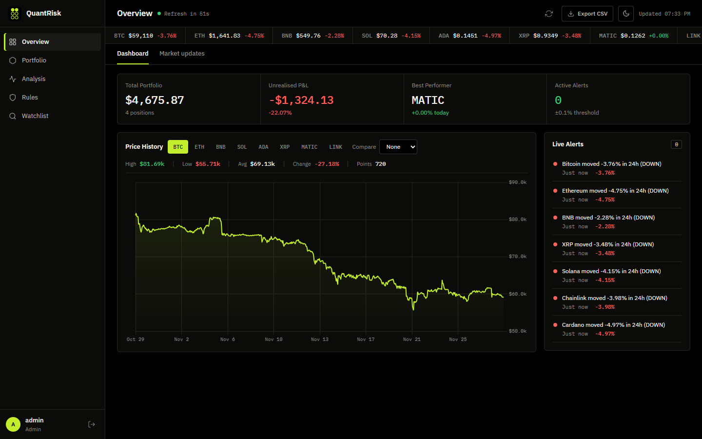
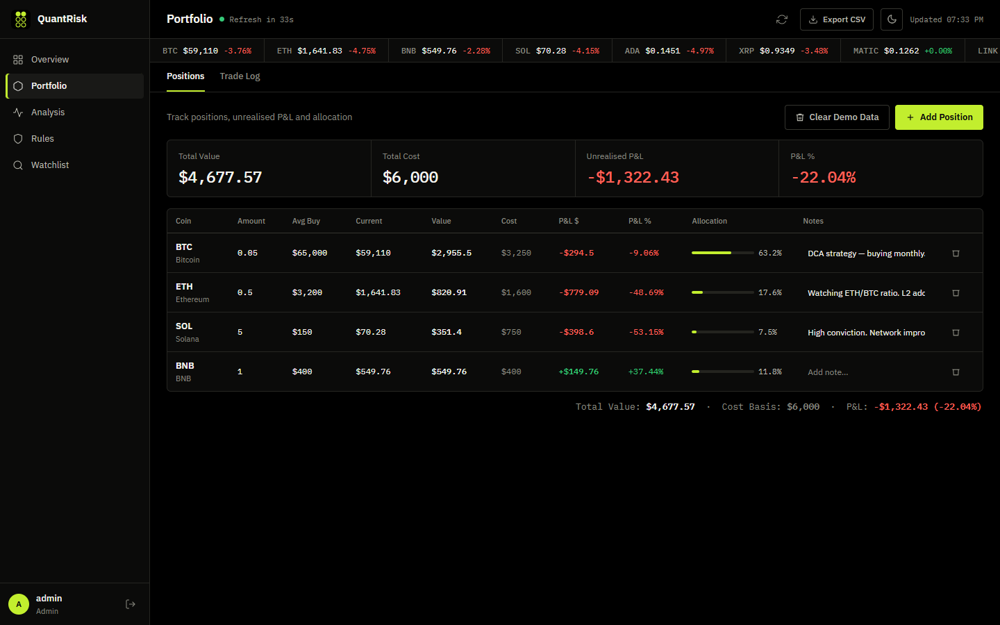
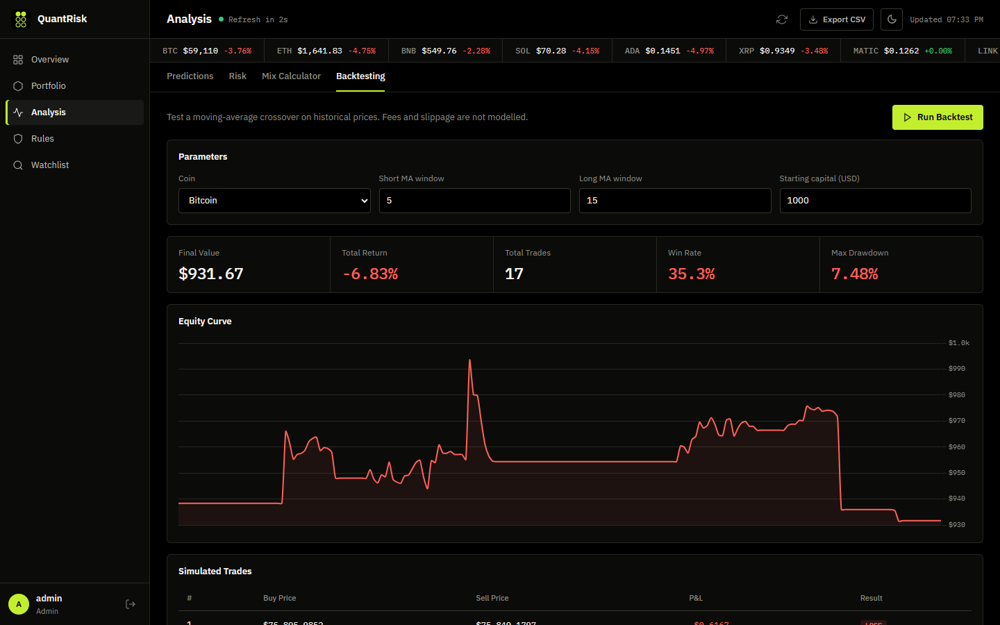

#  QuantRisk

A Flask web app for tracking a crypto portfolio, measuring its risk, comparing allocations and backtesting simple trading strategies. It stores data in SQLite and gets market data from CoinGecko. I built it in five milestones during an Infosys Springboard 6.0 internship.

Live site: https://cryptomanagerapp.vercel.app

Every result is an estimate based on past prices. It is not financial advice.



The screenshots come from a local run with sample holdings.

## What it does

| Page | Contents |
|---|---|
| Overview | Portfolio summary, price history charts, alerts for 24-hour moves, and market updates |
| Portfolio | Positions with unrealised profit and loss, and a trade log with FIFO realised profit and loss |
| Analysis | Price estimates, risk figures, allocation mixes and a backtest |
| Rules | Current holdings against a risk-parity target, correlation warnings, stress scenarios and price alerts |
| Watchlist | Search CoinGecko and add coins |

The Export CSV button writes price, risk, estimate and alert files to a `reports/` folder on the server.

The market updates are lines that QuantRisk generates from CoinGecko trending and price data and from the alternative.me Fear and Greed index. They are not news articles.



## How the numbers are calculated

| Result | Method |
|---|---|
| Value at risk and expected shortfall | Historical, at 95% confidence |
| Other risk figures | Volatility, Sharpe, Sortino and Calmar ratios, and maximum drawdown |
| Allocation mixes | Mean-variance optimisation with SciPy's SLSQP solver, with at least 5% in each coin. Random sampling is used only if SciPy is missing. |
| Risk-parity target | Weights inversely proportional to volatility, limited to the allocation rules and then rescaled to 100% |
| Price estimates | Ridge regression on price indicators with scikit-learn, with linear regression as the fallback. RSI, MACD and Bollinger Bands are shown alongside. |
| Stress scenarios | Six fixed changes to the whole portfolio, from a 60% fall to a 50% rise |
| Monte Carlo stress (`/api/monte-carlo`, not shown in the dashboard) | 10,000 runs by default, up to 50,000. Each coin is sampled independently from its stored returns, so links between coins are not modelled. |
| Backtests | The dashboard runs a moving-average crossover. The API and command line also have RSI, Bollinger Band and ensemble strategies. Fees and slippage are not modelled. |

Limits to keep in mind:

- Risk figures are calculated per stored price snapshot and are not annualised. A new database is filled with 30 days of CoinGecko history for most of the default coins. The running app then adds a snapshot about every 60 seconds, so recent data is spaced much more closely than the older history.
- If CoinGecko cannot be reached, the app falls back to simulated prices. Price alerts and market updates skip these quotes, but they are still saved to price history and can affect charts, portfolio values, risk figures and the 24-hour move alerts.
- MATIC is still on the default list under its old CoinGecko ID. It is not in the 30-day history download and may show a flat price, which distorts its risk figures and allocation weights.



## Run it locally

You need Python 3.10 or later.

```bash
git clone https://github.com/harctik/Crypto-Investment-Manager.git
cd Crypto-Investment-Manager
python -m venv venv

# Windows
venv\Scripts\activate
# Linux or macOS
source venv/bin/activate

pip install -r requirements.txt
python app.py
```

Open http://localhost:5000.

### Accounts

There are no built-in passwords, and a new database has no accounts. Choose "Create an account" on the sign-in page.

You can also create starter accounts from environment variables. This happens only while the users table is empty. Each password must have at least 8 characters.

| Variable | Account created |
|---|---|
| `SEED_ADMIN_PASSWORD` | `admin`, with sample positions, trades and notes |
| `SEED_TRADER_PASSWORD` | `trader` |
| `SEED_DEMO_PASSWORD` | `demo` |

These variables do not change or remove accounts in an existing database. The repository includes a database, `data/crypto_data.db`, which a local run uses unless `DB_FILE` points somewhere else. It already contains accounts, so set `DB_FILE` to a new path to start empty.

### Test sign-in (local only)

For testing on your own computer, start the app with `DEMO_LOGIN=1` set in the environment. This enables a fixed test sign-in for the `admin` account. The values are defined in [`demo_login.py`](demo_login.py). If the database has no `admin` account, the first test sign-in creates one with sample holdings. An existing account is not changed, and it must have the Admin role.

The test sign-in is off by default. It accepts only requests from the same computer that carry no proxy headers, and it stays off when `FLASK_ENV=production` or on common hosting services. Do not enable it on a server that other people can reach.

### Settings

Set these as environment variables or in a `.env` file.

| Variable | Purpose |
|---|---|
| `SECRET_KEY` | Signs session cookies. Set a long random value on any deployment. Without it, each process makes its own key, so a restart signs everyone out, and multiple instances do not accept each other's sessions. |
| `DB_FILE` | Path to the SQLite database |
| `HOST`, `PORT` | Where `python app.py` listens. The defaults are `0.0.0.0` and `5000`; use `HOST=127.0.0.1` to keep the app on your own computer. |
| `COINGECKO_API_KEY` | Optional CoinGecko API key |
| `RISK_FREE_RATE` | Risk-free rate used in the ratios, 0.02 by default |
| `MONTE_CARLO_SIMS` | Default number of Monte Carlo runs |
| `EMAIL_ENABLED` | Set to `true` to let the command-line run email its 24-hour move alerts. See `config.py` for the other email settings. |

On Vercel, the app copies the bundled database to temporary storage. New accounts and other changes made there are not guaranteed to persist.

## Command line

```bash
python main.py
```

This runs the five milestones in order. It writes to the same database as the web app, adds sample positions if the first user's portfolio is empty, and saves CSV files to `reports/`.

| File | Contents |
|---|---|
| `app.py` | Web server and API |
| `database.py` | SQLite storage and CoinGecko client |
| `config.py` | Settings |
| `milestone1_setup.py` | Data setup |
| `milestone2_mix_calculator.py` | Allocation optimiser |
| `milestone3_risk_predictor.py` | Risk figures and price estimates |
| `milestone4_spreading_rules.py` | Allocation rules and stress tests |
| `milestone5_backtest.py` | Backtests |

## Tests

```bash
pip install pytest flake8
flake8 . --count --select=E9,F63,F7,F82 --show-source --statistics --exclude=venv,data
pytest tests/ -v
```

## Author

Avvari Naga Harthikanand (Harthik), Bangalore, Karnataka, India

- LinkedIn: https://www.linkedin.com/in/harthik
- GitHub: https://github.com/harctik
- Email: harthikanand90@gmail.com
