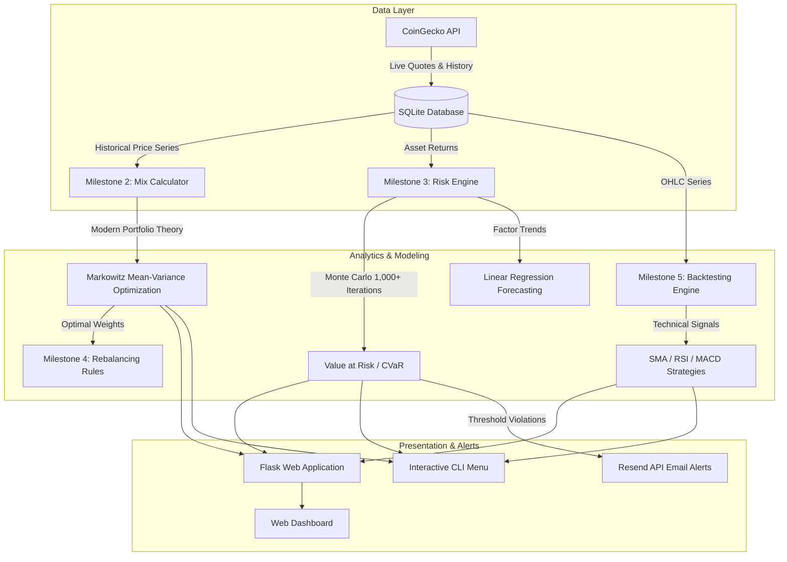

<div align="center">


# 📈 Crypto Investment Manager

**Quantitative cryptocurrency portfolio analytics, risk modeling, and backtesting platform built in Python & Flask.**

[Live Demo](https://cryptomanagerapp.vercel.app) • [Architecture](#-architecture) • [Features](#-core-features) • [Quantitative Models](#-quantitative-analytics) • [Quick Start](#-quick-start) • [Testing](#-testing)

</div>

---

## 🚀 Live Demo

The production web interface is deployed at: **[cryptomanagerapp.vercel.app](https://cryptomanagerapp.vercel.app)**

---

## 🏛️ Architecture



---

## ✨ Core Features

| Module | Capability | Engineering Implementation |
|---|---|---|
| **Data Ingestion** | Live Crypto Feeds | Resilient CoinGecko API fetcher with rate limiting and local SQLite caching |
| **Portfolio Optimizer** | Modern Portfolio Theory | Constrained SLSQP optimization maximizing Sharpe ratio and identifying the Efficient Frontier |
| **Risk Analytics** | Tail-Risk Modeling | Parametric & Historical Value at Risk (VaR 95/99), Conditional VaR (Expected Shortfall) |
| **Stress Testing** | Monte Carlo Engine | 1,000+ simulated market paths modeling extreme downside tail events |
| **Strategy Backtester** | Algorithmic Backtesting | Historical evaluation of SMA Crossover, RSI Oversold/Overbought, and Bollinger Band regimes |
| **Alerting System** | Anomaly & Breach Trigger | Automated email alerts dispatched via Resend API on volatility spikes |

---

## 📐 Quantitative Analytics

### 1. Modern Portfolio Theory (MPT)
Portfolio expected return and variance are formulated as:

$$\mathbb{E}[R_p] = \mathbf{w}^T \boldsymbol{\mu}, \quad \sigma_p^2 = \mathbf{w}^T \boldsymbol{\Sigma} \mathbf{w}$$

Subject to full-investment and allocation constraints:

$$\sum_{i=1}^n w_i = 1, \quad w_i \ge w_{\min}$$

### 2. Tail Risk (VaR & CVaR)
Downside risk is computed via historical simulation at confidence level $\alpha = 0.95$:

$$\text{VaR}_\alpha(L) = \inf \{ l \in \mathbb{R} : P(L > l) \le 1 - \alpha \}$$

$$\text{CVaR}_\alpha(L) = \mathbb{E}[L \mid L \ge \text{VaR}_\alpha(L)]$$

---

## 📁 Repository Structure

```
CryptoManager/
├── app.py                      # Flask web application & dashboard endpoints
├── config.py                   # Configuration, API endpoints & asset watchlist
├── database.py                 # SQLite schema, queries & CoinGecko integration
├── main.py                     # Interactive CLI execution entry point
├── milestone1_setup.py         # Workspace environment initialization
├── milestone2_mix_calculator.py # MPT, covariance matrix, efficient frontier
├── milestone3_risk_predictor.py # Monte Carlo simulation, VaR, CVaR, linear regression
├── milestone4_spreading_rules.py# Risk parity allocation & portfolio rebalancing
├── milestone5_backtest.py      # Technical indicators (RSI, MACD) & strategy backtesting
├── static/                     # CSS styling & client-side scripts
├── templates/                  # Jinja2 templates (dashboard, login, reports)
├── tests/                      # Automated unit test suite (pytest)
└── .github/workflows/          # GitHub Actions CI pipeline
```

---

## ⚡ Quick Start

### 1. Clone & Setup

```bash
git clone https://github.com/harctik/Crypto-Investment-Manager.git
cd Crypto-Investment-Manager
python -m venv venv
# On Windows:
venv\Scripts\activate
# On Linux/macOS:
source venv/bin/activate
pip install -r requirements.txt
```

### 2. Launch the Web Interface

```bash
python app.py
# Open: http://localhost:5000 (Default credentials: admin / admin123)
```

### 3. Or Run the CLI Menu

```bash
python main.py
```

---

## 🧪 Testing

The repository includes automated unit tests covering mathematical calculations, optimization constraints, and backtesting:

```bash
pytest tests/ -v
```

---

## 📄 License

This project is licensed under the MIT License.
